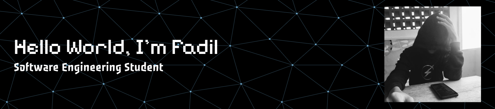

  

### 👨‍💻 About Me

Hello! I'm **Ahmad Fadil Mubarrok**, a Software Engineering (RPL) student at SMKN 1 Jenangan, East Java, Indonesia.

I'm passionate about technology and enjoy learning new things while continuously improving my programming skills.

- 🎓 Studying Software Engineering at <a href="https://smkn1jenpo.sch.id/"> **SMKN 1 Jenangan**</a>  
- 💻 Interested in web development, programming, and UI design 
- 🎯 Goal:To become a front-end developer and build cool, responsive websites.
- 📫 Email: **[fadilmubarrok0@gmail.com](mailto:fadilmubarrok0@gmail.com)**

### 🌐 Connect With Me

  
  

### 🌱 Currently Learning

  
  
  
  
    

### 🛠️ Languages & Tools

  
  
  

### 📊 GitHub Statistics

  

  

